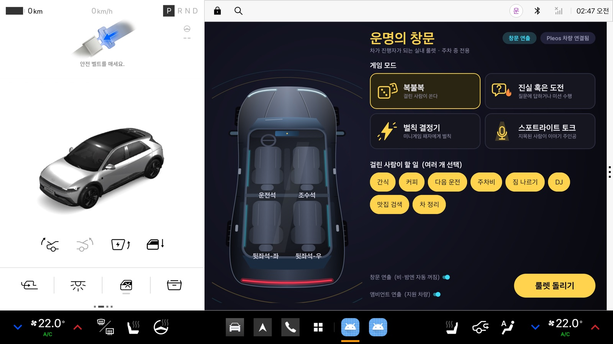
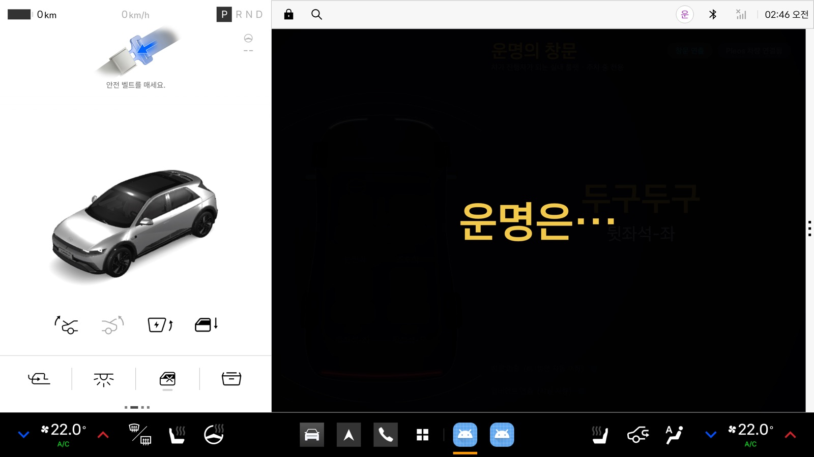
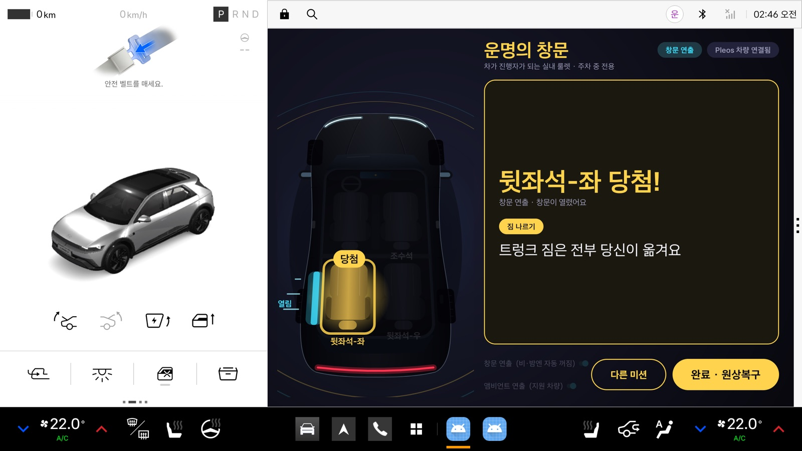
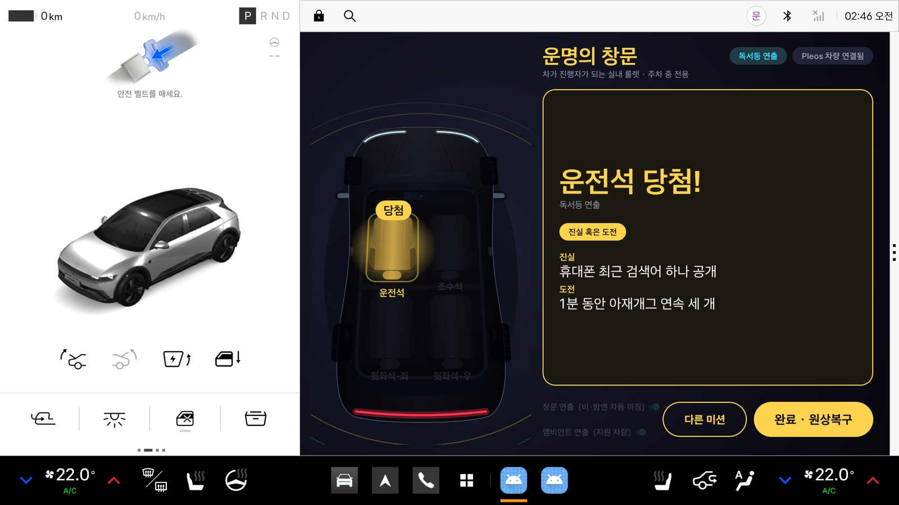
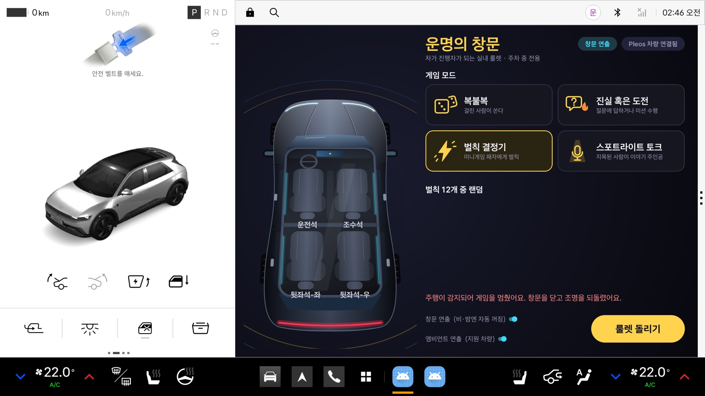

# 운명의 창문 (Fate Window)

> 현대자동차그룹 차량용 앱 개발 공모전 (Code your App into Pleos App Market) 출품작
> 접수: 2026.10.21 ~ 2026.11.15 23:59 · 분야: 인카 엔터테인먼트
> **Pleos Vehicle SDK 2.3.2 로 실제 구현 · Pleos Connect Emulator v2.1.0 에서 동작 확인**
>
> **APK:** [`apk/운명의창문팀_운명의창문_release.apk`](apk/) (release 빌드) · **시연 영상 (78초):** [다운로드](https://github.com/Jone4865/pleos-fate-window/releases/download/v1.0/fate-window-demo.mp4) · **릴리스:** [v1.0](https://github.com/Jone4865/pleos-fate-window/releases/tag/v1.0)



## 심사용 빠른 실행

**APK 위치:** 저장소 [`apk/운명의창문팀_운명의창문_release.apk`](apk/) (서명된 release 빌드, versionName 1.0). [Release v1.0](https://github.com/Jone4865/pleos-fate-window/releases/tag/v1.0) 에도 같은 파일을 올려 두었습니다.

**테스트 환경**
| 항목 | 내용 |
| --- | --- |
| 에뮬레이터 | Pleos Connect Emulator v2.1.0 (Android 14, API 34, Automotive) |
| 차량 상태 조작 | Pleos Connect Virtual Console (에뮬레이터 내장) |
| 확인한 호스트 | macOS (Apple Silicon), Android Emulator 37 |
| 최소 요구 | Android API 28 이상 |

**필요한 설정**
1. Android Studio → SDK Manager → SDK Update Sites 에 Pleos Connect 시스템 이미지 추가
   (Mac: `https://nexus-playground.pleos.ai/repository/raw-releases/connect-avd/2.x/crp-arm64-sys-img.xml`, Windows/Linux: `.../crp-sys-img.xml`) → API 34 Pleos Connect 이미지 설치 → Automotive AVD 생성 (RAM 4GB, Cold boot)
2. 에뮬레이터 부팅 후 Virtual Console 연결: `adb forward tcp:8088 tcp:8088` → 브라우저 `http://127.0.0.1:8088/` → **하단이 DDS ONLINE 인지 확인** (이 상태여야 앱의 조명·창문 제어가 차량 상태에 반영됩니다)
3. Virtual Console 에서 기어 **P** 확인

**실행 방법**
1. `adb install "apk/운명의창문팀_운명의창문_release.apk"` → 앱 목록에서 "운명의 창문" 실행 (차량 퍼미션은 설치 시 자동 허용)
2. 상단에 "Pleos 차량 연결됨"이 보이면 게임 모드 선택 → **룰렛 돌리기**
3. 결과 화면에서 **완료 · 원상복구** 를 누르면 창문이 닫히고 조명이 돌아옵니다
4. 연출 전환 확인: Virtual Console 에서 앞 와이퍼를 Low 로 바꾸면 "독서등 연출 · 비 감지"로 바뀌고 창문 없이 조명만으로 지목합니다
5. 안전 확인: 결과 화면(창문 열림)에서 기어를 P 밖으로 옮기면 즉시 중단되고 창문이 닫힙니다

> Pleos 차량 서비스가 없는 일반 Android 기기에서는 "데모 모드"로 화면 연출만 동작합니다.

---

## 1. 한 줄 소개

**주차 중인 차 안에서, 차량이 직접 진행자가 되어 조명 룰렛과 창문으로 당첨자를 지목하는 공개 파티 게임.**

폰 화면 속 룰렛이 아니라, **차 실내 전체가 룰렛판**이 된다. 독서등이 좌석을 타고 두구두구 돌다가 멈추고, 완전 암전 뒤 **당첨자 좌석만 불이 켜지며 그쪽 창문이 스르륵 열린다.** 스마트폰으로는 구조적으로 불가능한, 차량 하드웨어만의 경험.

## 2. 타겟 & 상황 (페인포인트)

- **타겟:** 주차 중 차 안에 함께 있는 2~4인 (친구·커플·가족·동호회)
- **상황:** 캠핑장·차박·드라이브 쉼터·약속 대기·식당 주차장 등 "차 안에서 붕 뜨는 시간"
- **페인포인트:** 차 안에서 할 게 폰밖에 없다. 여럿이 같이 즐길 거리가 없다. 사다리/제비뽑기는 폰 돌려봐야 하고 긴장감이 없다.
- **해결:** 차가 공정한 진행자가 되어, 공간 전체를 쓰는 물리 연출로 "같이 보는 재미"를 만든다.

## 3. 핵심 경험 — 연출 시퀀스

| 단계 | 차에서 일어나는 일 | 화면 |
| --- | --- | --- |
| 1. 대기 | 착좌 감지로 앉은 사람만 참가자 등록 | 실내 일러스트에 좌석 표시, 빈 좌석은 흐리게 |
| 2. 암전 | 실내등·독서등·앰비언트 전부 OFF, 멘트 "운명의 창문, 시작합니다" | 실내가 어두워짐 |
| 3. 룰렛 | **독서등이 좌석을 타고 순서대로 점멸**, 점점 감속 | 같은 좌석에 빛 원뿔이 돈다, "두구두구" |
| 4. 완전 암전 | 1.5초간 정적, 멘트 "운명은…" | 전체 화면 암전 |
| 5. 운명의 순간 | **당첨 좌석 독서등만 점등 + 그쪽 창문 50% 오픈** | 당첨 배지, 창문 열림·바람 애니메이션 |
| 6. 미션 | 모드별 미션 카드 + 음성 안내, "다른 미션"으로 다시 뽑기 | 결과 카드 |
| 7. 완료 | **창문 닫고 조명을 암전 전 상태로 복구** | 준비 화면 |

| 완전 암전 | 당첨 + 창문 오픈 |
| --- | --- |
|  |  |

### 하드웨어·날씨별 연출 자동 분기 (Graceful Degradation)

라운드마다 차량 상태를 다시 읽어 **룰렛·지목 연출을 자동으로 고른다.** 어떤 차, 어떤 날씨에서도 핵심 경험이 성립한다.

| 티어 | 조건 | 룰렛 | 당첨 지목 |
| --- | --- | --- | --- |
| **1. 앰비언트 연출** | 좌석별 앰비언트 지원 차량 | 앰비언트가 좌석 둘레를 회전 | 당첨 좌석 앰비언트+독서등 (+창문) |
| **2. 창문 연출** | 창문 제어 가능 + 비·밤 아님 | 독서등 회전 | **당첨자 창문 오픈** |
| **3. 독서등 연출** | 비(와이퍼 작동) 또는 밤(전조등 켜짐), 또는 사용자가 창문 연출 OFF | 독서등 회전 | 당첨 좌석 독서등만 |



## 4. 게임 모드 (룰렛 엔진은 같고 미션만 바뀜)

| 모드 | 내용 | 미션 |
| --- | --- | --- |
| **복불복** | 걸린 사람이 쏜다 | 내기 항목 8종 중 원하는 것만 칩으로 선택: 간식, 커피, 다음 운전, 주차비, 짐 나르기, DJ, 맛집 검색, 차 정리 |
| **진실 혹은 도전** | 질문에 답하거나 미션 수행 | 진실 12 · 도전 12 중 한 쌍 출제 |
| **벌칙 결정기** | 미니게임 패자에게 벌칙 | 벌칙 12종 |
| **스포트라이트 토크** | 지목된 사람이 이야기 주인공 (가족·커플 대화용) | 대화 주제 12종 |

- 직전 당첨자 연속 당첨 방지, "다른 미션"으로 같은 모드 안에서 다시 뽑기
- 미션은 화면 표시 + 음성으로 읽어줌

## 5. 화면 (차량 디스플레이 전용 디자인)

- 원거리 시청 기준: 본문 24sp 이상, 제목 60sp, 버튼 높이 112dp
- 왼쪽: **원근 3D 시점의 차량 실내 일러스트** — 이미지 에셋 없이 Canvas 로 직접 그렸고, 실제 차량에서 일어나는 조명·암전·창문 상태를 그대로 재현한다
- 오른쪽: 모드 카드(직접 그린 벡터 아이콘) → 룰렛 진행 → 결과 카드 순으로 전환
- 상단 배지: 이번 라운드 연출(창문/독서등/앰비언트, 비·야간 감지)과 차량 연결 상태

## 6. Pleos Vehicle SDK 활용 (기술 활용성)

`ai.pleos.playground:Vehicle:2.3.2` — 아래 호출을 모두 실제로 구현하고 에뮬레이터에서 확인했다.

| 연출 | SDK API | 퍼미션 |
| --- | --- | --- |
| 참가자 자동 등록 | `Seat.getCurrentSeatOccupancy(SeatArea)` | `CAR_SEATS` |
| 주차 안전 조건 | `Gear.getCurrentGearSelectionState()` == `GEAR_PARK` | `CAR_DRIVE` |
| 비 감지 → 창문 OFF | `Wiper.getCurrentWiperState / Switch(FRONT_WINDSHIELD)` | `CAR_WINDOWS` |
| 밤 감지 → 창문 OFF | `Light.getCurrentLowBeamLightState()` | `CAR_LIGHTS` |
| 룰렛 / 당첨 스포트라이트 | `Light.setReadingLightSwitch(SeatArea, ON/OFF)` | `CONTROL_CAR_LIGHTS` |
| 완전 암전 / 복구 | `Light.setCabinLightSwitch(OFF)` + 이전 상태 저장·복원 | `CONTROL_CAR_LIGHTS` |
| 앰비언트 연출 (차종 옵션) | `Light.checkAmbientLightSwitchCapabilities` → `setAmbientLightSwitch(SeatArea)` | `CONTROL_CAR_LIGHTS` |
| 당첨자 창문 오픈 / 닫기 | `Window.checkWindowPositionCapabilities` → `setWindowPosition(WindowArea, value)` | `CONTROL_CAR_WINDOWS` |
| 진행 멘트 | Android `TextToSpeech` (Pleos TTS SDK 는 포털에서 준비 중) | - |

구현 포인트
- **차종 차이를 capability 로 흡수:** 창문 위치 범위(에뮬레이터 0~10)를 읽어 %로 환산하고, 앰비언트는 차가 제공하는 영역 단위 그대로 제어한다. 좌석 단위 앰비언트가 없으면 티어1을 쓰지 않는다.
- **SDK 콜백 → 코루틴:** 모든 호출을 `suspend` 로 감싸 실패·타임아웃 시 게임이 멈추지 않고 다음 연출로 넘어간다.
- **스텁 자동 대체:** Pleos 차량 서비스가 없는 기기에서는 `StubVehicleController` 로 동작해 일반 폰에서도 앱을 띄워볼 수 있다.

## 7. 안전 / 예외 처리



- **주차(기어 P)에서만 시작.** 룰렛 매 스텝·당첨 직전에 기어를 다시 확인한다. (SDK에 차속 API가 없어 기어로 판정)
- **주행 전환 즉시 중단 + 복구:** 라운드 중이든 결과 화면(창문 열린 상태)이든 P 를 벗어나는 순간 창문을 닫고 조명을 원상복구한다.
- **앱이 화면에서 사라져도 복구:** 라운드 중 홈 버튼·앱 전환·종료 시 열어 둔 창문을 닫고 조명을 되돌린다.
- **창문은 옵션 레이어:** 비·야간이면 자동으로 끄고 독서등만으로 완결. 사용자 토글로 언제든 끌 수 있다. 창문은 최대 50%만 연다.

## 8. 심사 기준 매칭

| 기준 | 어필 포인트 |
| --- | --- |
| **차량특화성** | 독서등·실내등·창문 물리 연출로 "차 전체가 룰렛판". 착좌·기어·와이퍼·전조등을 읽어 차 상태에 맞게 반응 — 모바일로는 구조적으로 불가. |
| **창의성** | "조명 룰렛 + 암전 + 창문 지목"이라는 새로운 인터랙션. 차 안의 무료한 시간이라는 명확한 페인포인트. |
| **기술 활용성** | Vehicle SDK의 Seat·Gear·Wiper·Light·Window 도메인을 조회와 제어 모두 코어 경험에 사용. capability 기반 차종 대응, 안전 가드, 단위테스트 16개, CI 자동 빌드. |
| **사업성** | 차박·캠핑·동호회 반복 이용, 테마팩·시즌 이벤트·브랜드 콜라보로 확장. |

> 참고: 대상작 '창밖동화'가 "스토리 전개에 맞춘 창문 개폐 = SDV만의 차별화"로 호평받았다. 본 작품은 창문 지목을 코어로 삼되 **파티 게임이라는 다른 맥락**으로 차별화한다.

## 9. 사업성 / 확장

- **테마팩:** 핼러윈 공포 벌칙, 크리스마스, 연말 시상식 등 시즌 미션 팩
- **인원·좌석 확장:** 3열 좌석(SDK 의 ROW_3 영역), 팀전
- **콜라보:** 음료·간식 브랜드 복불복 스폰서, 휴게소/캠핑장 제휴
- **지속 이용:** 이동 때마다 꺼내 쓰는 "차 안 국민게임" 포지션

## 10. 구조와 실행 방법

```
app/src/main/java/com/fatewindow/app/
  MainActivity.kt                 화면 상태(준비/룰렛/결과), 안전 감시
  ui/CabinView.kt                 원근 3D 차량 실내 일러스트 + 연출 애니메이션
  game/GameController.kt          라운드 오케스트레이션, 주행 가드, 비상 복구
  game/RouletteEngine.kt          공정 랜덤 + 감속 회전 시퀀스
  game/RevealTier.kt              차량 상태 → 연출 티어 결정
  game/Missions.kt                모드·미션 풀
  vehicle/VehicleController.kt    차량 추상화 (suspend)
  vehicle/PleosVehicleController.kt  Pleos Vehicle SDK 구현 + TTS
  vehicle/StubVehicleController.kt   SDK 없는 기기용
app/src/test/                     단위테스트 16개 (게임 흐름·안전·미션·룰렛)
```

- **빌드:** `./gradlew assembleRelease` (JDK 17, Android SDK 34). release 서명 정보는 저장소 밖 `~/.android/fate-window-signing/keystore.properties` 에서 읽는다. `main` 푸시 시 GitHub Actions 가 단위테스트와 디버그 빌드를 확인한다.
- **에뮬레이터:** Android Studio SDK Manager 에 Pleos Connect 시스템 이미지(Mac: `https://nexus-playground.pleos.ai/repository/raw-releases/connect-avd/2.x/crp-arm64-sys-img.xml`)를 추가해 Automotive AVD 생성.
- **Virtual Console (필수):** `adb forward tcp:8088 tcp:8088` → 브라우저 `http://127.0.0.1:8088/`. 하단이 **DDS ONLINE** 이어야 앱의 제어가 차량 상태에 반영된다. 기어·착좌·와이퍼·전조등을 여기서 바꿔 티어 전환과 안전 중단을 시연할 수 있다.

## 11. 제출물

- [x] 기획서 (본 문서)
- [x] GitHub 저장소 (소스 코드) + APK (`apk/` 폴더, release 빌드)
- [x] [시연 영상](https://github.com/Jone4865/pleos-fate-window/releases/download/v1.0/fate-window-demo.mp4) (에뮬레이터 + Virtual Console 실제 구동, 78초)
- [ ] 1차 접수 (~11/15 23:59)

## 12. 리스크

- **Vehicle Control 포털 상태:** 개발자 포털에서 창문·조명 제어는 아직 "준비 중"(2026-11-10)이다. 에뮬레이터에서는 제어 퍼미션이 허용되어 정상 동작하므로 에뮬레이터 시연을 기본으로 하고, 실차에서 제어가 막히면 독서등 연출(티어3) 또는 화면 연출로 동작한다.
- **실차 창문 actuation:** OEM 안전정책 제약 가능 → 창문 연출 토글 OFF 로 조명만으로 완결.
- **차종별 좌석·조명 구성:** capability 조회로 지원 영역만 사용.
